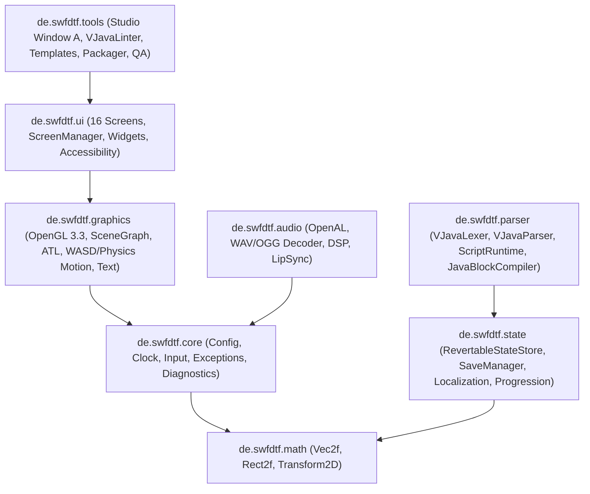

# KAGAYAKI Entwickler-Handbuch (Deutsch)

> **Engine:** KAGAYAKI (`de.swfdtf`) · Java 21 LTS · LWJGL 3 (OpenGL 3.3 Core, GLFW, OpenAL, STB) · `.vjava` 1.1 Hybrid-DSL

## 1. Architektur-Überblick

Details zu den Paketgrenzen liegen in [ARCHITEKTUR.md](ARCHITEKTUR.md) und in den jeweiligen `AGENT_CONTEXT.md`-Dateien (z. B. [core/AGENT_CONTEXT.md](../src/main/java/de/swfdtf/core/AGENT_CONTEXT.md)).

## 2. `.vjava` 1.1 DSL & Interaktive Steuerung

- **Visual Novel Basis:** `define`, `image`, `layeredimage`, `label`, `jump`, `call`, `menu`, `if`/`else`/`elif`, `match`, `pause`, `return`.
- **Bewegung & Physik:** `move <tag> to <x> <y>`, `move_by`, `move_path`, `rotate`, `scale`, `wasd_init`, `wasd_stop`, `physics_init`, `physics_stop`, `solid_platform`, `on_collide`, `on_overlap`, `camera follow`.
- **Bedingungen:** `==`, `!=`, `<`, `<=`, `>`, `>=`, `and`, `or`, `not`, `in <low>..<high>`, `between <low> and <high>`.
- **Eingebettetes Java 21:** `@->{ ... }<<` kompiliert im Arbeitsspeicher gegen `engine`, `state`, `persistent` und `scene`.

Siehe die vollständige Syntax-Referenz in [VJAVA_SPEZIFIKATION.md](VJAVA_SPEZIFIKATION.md) und [sprachreferenz.md](sprachreferenz.md).

## 3. Dual-Window Studio (Window A + Window B)

1. Studio (`./gradlew run`) startet im Project Hub mit Version-Banner (`EngineVersion`: `KAGAYAKI v1.0.0 (vJava 1.1)`), Vorlagen-Generator (`FULL_DEMO`, `STARTER`, `MINIMAL`, `ACTION_ADVENTURE_2D`, `HYBRID_3D_EXPLORATION`, `HYBRID_3D_MYSTERY`, `NVL_LITERARY`, `TUTORIAL_5_MIN`, `SANDBOX_2D_LAB`), persistenter Workspace-Speicherung (`~/.kagayaki/studio.json` über `StudioWorkspaceState`), klickbarer Recent-Projects-Liste inkl. Live-Reload auf Window B, `ProjectDescriptor.useCustomMainMenuScreen`-Umschaltung (`template_main_menu` vs. Dark-Slate-Hauptmenü) und Live-Inspektoren.
2. Vorlagen-Walkthrough: [TUTORIAL_ERSTES_PROJEKT.md](TUTORIAL_ERSTES_PROJEKT.md).
3. Release-Smoke-Prüfung: [GUI_SMOKE_CHECKLIST.md](GUI_SMOKE_CHECKLIST.md).
4. Architektur- & Build-Guards (`ArchitectureGuardTest`): Automatisierte Import-Audits sichern schichtsaubere Pakete (`0` Imports aus `parser`/`ui`/`tools` in `de.swfdtf.state`) und verbieten `java.awt.*`/`javax.imageio.*` im Produktivcode (Roadmap `1.021 / 1.021` Ziele abgeschlossen).

## 4. Packaging, Save-System, 3D & Cloud/WASM-Ausbau

- Speicherstände (`saves/slot_*.ksav`, `saves/persistent.dat`, `saves/preferences.json`) und plattformneutrale Cloud-Sync-Manifeste (`CloudSyncManifest`): dokumentiert in [SAVE_SCHEMA.md](SAVE_SCHEMA.md).
- `.vpak`-Bundles inkl. vorkompilierter `.vjava`-Bytecode-Bundles (`META-INF/compiled-scripts.vjc`), VFS-Prioritäten (`Mods > DLC > Base > Classpath`) und Ed25519-Prüfsummen: dokumentiert in [PACKAGING_AND_MODDING.md](PACKAGING_AND_MODDING.md).
- Erweiterte 3D- & Studio-Funktionen (`[P3]` Waves P3-1–P3-4): 2D-A*-Pfadfindung (`GridPathfinder2D`), 2D-Skeletal-Adapter (`Skeletal2DAdapter`), Label-Hot-Swap ohne State-Reset, 3D-IBL/SSAO/DoF/God-Rays/SSS/Panorama-Baking/RenderDoc-Marker, glTF-Skinning, `InstancedMeshNode`, OpenAL-3D-Hörer-Kopplung, Git-`HEAD`-Dialogdiff, Multi-Window-Abdocken, `DialogPacingLinter` sowie `VisualNodeGraphEditor`.
- Browser-/WASM-Machbarkeitsstudie: [WEBASSEMBLY_FEASIBILITY.md](WEBASSEMBLY_FEASIBILITY.md).
- Performance-Baselines: [BENCHMARKS.md](BENCHMARKS.md).
- Englische Dokumentation: [GUIDE_EN.md](GUIDE_EN.md) · Sicherheit: [SECURITY.md](../SECURITY.md) · Mitwirken: [CONTRIBUTING.md](../CONTRIBUTING.md).
