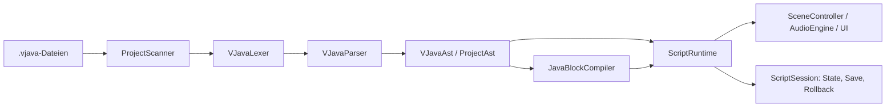

# Erste Schritte mit vjava

Schritt-für-Schritt-Anleitung vom Klonen des Repositorys bis zum ersten laufenden `.vjava`-Programm.

> **Wichtig zum Verständnis:** vjava ist eine **Skriptsprache für die Visual-Novel-Engine KAGAYAKI**. Es gibt keinen eigenständigen Kommandozeilen-Interpreter wie `vjava datei.vjava`. Stattdessen startest du die **Engine** (Java 21 + LWJGL 3) und gibst ihr einen **Projektordner** mit `.vjava`-Dateien. Die Engine öffnet ein Fenster, parst die Skripte und führt sie aus. Die Sprachsyntax steht in der [Sprachreferenz](sprachreferenz.md).

## Inhalt

1. [Voraussetzungen](#1-voraussetzungen)
2. [Installation & Setup](#2-installation--setup)
3. [Engine auf der Konsole starten (CLI)](#3-engine-auf-der-konsole-starten-cli)
4. [Das erste Programm: „Hello World“](#4-das-erste-programm-hello-world)
5. [Starterprojekt & Demo](#5-starterprojekt--demo)
6. [Skripte prüfen & Fehler finden](#6-skripte-prüfen--fehler-finden)
7. [Spiel verpacken](#7-spiel-verpacken)
8. [Projektstruktur des Quellcodes](#8-projektstruktur-des-quellcodes)
9. [vjava erweitern](#9-vjava-erweitern)
10. [Fehlerbehebung](#10-fehlerbehebung)

---

## 1. Voraussetzungen

| Komponente | Anforderung | Hinweis |
| :--- | :--- | :--- |
| **JDK** | **Java 21 oder neuer** (nicht 17!) | `build.gradle` setzt `sourceCompatibility = JavaVersion.VERSION_21`. Ein **JDK** (kein reines JRE) ist nötig, weil `@->{ … }<<`-Blöcke zur Laufzeit mit `javax.tools.JavaCompiler` kompiliert werden. |
| **Build-Tool** | **Gradle** | Der Wrapper (`gradlew` / `gradlew.bat`) liegt im Repository – eine eigene Gradle-Installation ist **nicht** nötig. Maven wird nicht verwendet. |
| **Git** | beliebig aktuell | Zum Klonen. |
| **Grafik** | OpenGL-fähige GPU/Treiber | Die Engine rendert mit LWJGL/GLFW/OpenGL. |
| **Audio** | OpenAL (über LWJGL gebündelt) | Keine Zusatzinstallation. |
| **Editor** | beliebig (UTF-8) | z. B. IntelliJ IDEA oder VS Code. |

Version prüfen:

```bash
java -version      # muss 21 oder höher anzeigen
javac -version     # beweist, dass ein JDK installiert ist
```

Unterstützte Plattformen: Windows, macOS (Intel und Apple Silicon) und Linux (x64 und arm64). Die passenden LWJGL-Natives werden automatisch gewählt. Auf macOS setzt Gradle selbstständig das nötige JVM-Argument `-XstartOnFirstThread`.

---

## 2. Installation & Setup

### 2.1 Repository klonen

```bash
git clone https://github.com/SWFDtf/KAGAYAKI.git
cd KAGAYAKI
```

### 2.2 Bauen

```bash
./gradlew build          # macOS / Linux
gradlew.bat build        # Windows
```

Der erste Lauf lädt Gradle und alle Abhängigkeiten (LWJGL 3.3.6, JOML 1.10.8, Gson 2.11.0, JUnit, Mockito) und benötigt Internet. `build` führt auch die Tests aus; nur kompilieren: `./gradlew compileJava`.

### 2.3 Tests ausführen (optional)

```bash
./gradlew test
```

### 2.4 Gradle-Aufgaben im Überblick

| Aufgabe | Zweck |
| :--- | :--- |
| `./gradlew runStudio` | Startet den **Studio-Modus** (zwei Fenster: Werkzeug + Live-Vorschau). |
| `./gradlew runStandalone` | Startet nur das **Spielfenster** ohne Studio-Werkzeuge. |
| `./gradlew packageStandalone` | Baut ein ausführbares JAR: `build/dist/kagayaki-standalone-<version>.jar`. |
| `./gradlew test` | Führt alle JUnit-Tests aus. |

Mit `-PkagayakiProject=<pfad>` wählst du das Projekt aus (Pfad zum Ordner mit `project.vjava.json`).

---

## 3. Engine auf der Konsole starten (CLI)

### 3.1 Über Gradle

```bash
# Studio-Modus mit Projekt
./gradlew runStudio -PkagayakiProject=/pfad/zu/meinem_projekt

# Nur Spiel (Standalone)
./gradlew runStandalone -PkagayakiProject=/pfad/zu/meinem_projekt
```

Ohne `-PkagayakiProject` sucht die Engine automatisch ein Projekt: zuerst `./project.vjava.json` im aktuellen Ordner, dann `./demo/project/project.vjava.json`.

### 3.2 Direkt über die Java-Klassen

| Einstiegspunkt | Klasse | Standardmodus |
| :--- | :--- | :--- |
| Studio/Allgemein | `de.swfdtf.Main` | Studio (zwei Fenster), sofern nicht `--standalone` |
| Exportierte Spiele | `de.swfdtf.StandaloneMain` | Immer Standalone |

### 3.3 Kommandozeilen-Flags

| Flag | Argument | Beschreibung |
| :--- | :--- | :--- |
| `--studio` | – | Studio-Modus (Dual-Window). |
| `--standalone [<dir>]` | optionaler Projektordner | Nur Spielfenster; der Ordner darf direkt folgen. |
| `--project <dir>` / `--project=<dir>` | Pfad | Projektordner. |
| `--create-template <dir>` / `--create-template=<dir>` | Pfad | Erzeugt ein vollständiges **Starterprojekt** im Ordner und startet damit. |
| `--mode 2D\|3D` (Alias `--render-mode`), `--2d`, `--3d` | `2D` oder `3D` | Render-Modus. |
| `--width <n>`, `--height <n>` | positive Ganzzahl | Logische Auflösung (Standard 1920×1080). |
| `--fps <n>` (Alias `--target-fps`) | positive Ganzzahl | Ziel-Bildrate. |
| `--vsync` / `--no-vsync` (auch `--vsync=true\|false`) | – | VSync an/aus. |
| `--headless` | – | Ohne sichtbares Fenster. |
| `--smoke-test` | – | Kurzer Startdurchlauf zur Prüfung. |

Beispiel:

```bash
./gradlew runStandalone -PkagayakiProject=/pfad/zu/projekt
```

oder, wenn du die Klassen selbst startest (nach `./gradlew build`, mit dem Klassenpfad aus deiner IDE):

```bash
java -XstartOnFirstThread de.swfdtf.Main --standalone /pfad/zu/projekt   # -XstartOnFirstThread nur auf macOS
```

> **Tipp:** In IntelliJ IDEA kannst du `de.swfdtf.Main` direkt mit den obigen Programmargumenten starten. Auf macOS muss dabei das VM-Argument `-XstartOnFirstThread` gesetzt sein.

---

## 4. Das erste Programm: „Hello World“

### 4.1 Projektordner anlegen

```bash
mkdir -p ~/vjava/hello
cd ~/vjava/hello
```

### 4.2 `project.vjava.json` erstellen

Diese Datei beschreibt das Projekt. Fehlt sie, erzeugt die Engine Standardwerte – für die automatische Projekterkennung sollte sie aber vorhanden sein.

```json
{
  "title": "Hello vjava",
  "entryLabel": "start"
}
```

Alle Felder (alle optional):

| Feld | Typ | Standard | Beschreibung |
| :--- | :--- | :--- | :--- |
| `title` | String | `"Untitled KAGAYAKI Project"` | Projekttitel |
| `version` | String | `"1.0.0"` | Projektversion |
| `author` | String | `""` | Autor |
| `renderMode` | String | `"2D"` | `"2D"` oder `"3D"` |
| `logicalWidth` / `logicalHeight` | int | `1920` / `1080` | Logische Auflösung |
| `entryLabel` | String | `"start"` | Label, mit dem das Skript beginnt |
| `defaultLanguage` | String | `"deutsch"` | Standardsprache |
| `dialogueMode` | String | `"ADV"` | `"ADV"`, `"NVL"` oder `"BUBBLE"` |
| `windowTitle` | String | = `title` | Fenstertitel |
| `iconPath` | String | `""` | Pfad zum Fenster-Icon |

### 4.3 `main.vjava` schreiben

Datei `~/vjava/hello/main.vjava` (UTF-8, **4 Leerzeichen** Einrückung):

```vjava
define a = Character("Aoi", color="#7aa2ff")

label start:
    "Hallo, Welt! Das ist mein erstes vjava-Programm."
    a "Schön, dass du da bist."
    return
```

So liest du es:

| Zeile | Bedeutung |
| :--- | :--- |
| `define a = Character("Aoi", color="#7aa2ff")` | Legt den Sprecher `a` mit Anzeigename „Aoi“ und blauer Namensfarbe an. |
| `label start:` | Startpunkt (entspricht `entryLabel` aus der JSON-Datei). |
| `"Hallo, Welt! …"` | Text ohne Sprecher = Erzähler. Der Spieler klickt weiter. |
| `a "Schön, …"` | Dialogzeile des Sprechers `a`. |
| `return` | Beendet das Skript. |

Bei der Statement-Verschachtelung zählt die Einrückung: alles Eingerückte unter `label start:` gehört zum Label.

### 4.4 Ausführen

Aus dem Repository-Ordner `KAGAYAKI`:

```bash
./gradlew runStandalone -PkagayakiProject=$HOME/vjava/hello
```

Es öffnet sich das Spielfenster mit deinem Text; mit einem Mausklick (oder den im Controls-Screen belegten Tasten) schaltest du weiter. Zum Entwickeln mit Live-Vorschau verwendest du stattdessen `runStudio`:

```bash
./gradlew runStudio -PkagayakiProject=$HOME/vjava/hello
```

Im Studio-Modus lädt **`Shift+R`** das Skript neu und behält die aktuelle Position und Variablen bei.

### 4.5 Nächste Ausbaustufe

Erweitere `main.vjava` um Variablen, Menü, Hintergrund und Musik (Assets müssen existieren):

```vjava
define a = Character("Aoi", color="#7aa2ff")
default mut = 0

label start:
    a "Willst du ein Abenteuer erleben?"
    menu:
        "Ja" -> jump abenteuer
        "Nein" -> jump ende

label abenteuer:
    $ mut += 1
    a "Mut: [mut]. Los geht's!"
    jump ende

label ende:
    "Ende."
    return
```

Alle Bausteine – Bilder, Audio, Transitions, Animationen, UI, Java-Blöcke – stehen in der [Sprachreferenz](sprachreferenz.md).

---

## 5. Starterprojekt & Demo

### 5.1 Starterprojekt generieren

```bash
./gradlew run --args="--create-template /pfad/zum/neuen_projekt"
```

> Hinweis: Die Gradle-Aufgabe `run` startet `de.swfdtf.Main` (Studio-Modus) und wird vom `application`-Plugin bereitgestellt. Alternativ startest du `de.swfdtf.Main` mit `--create-template <dir>` in deiner IDE.

Der Generator (`ProjectTemplateGenerator`) erzeugt `project.vjava.json`, `main.vjava` (mit Java-Klassen, `layeredimage`, Verzweigung), `ui/screens.vjava`, `tl/english/translations.vjava` sowie prozedurale PNG- und WAV-Assets.

### 5.2 Demo „Schneewittchen“

Im Ordner `demo/project/` liegt ein vollständiges Beispielspiel (vier Kapitel, UI-Screens, Übersetzung, Audio). Es ist auch der **Standard**, wenn im Repository-Stamm kein Projekt angegeben wird:

```bash
./gradlew runStudio
```

Zum Lernen eignen sich besonders `demo/project/main.vjava` (Definitionen), `demo/project/kapitel/*.vjava` (Handlung) und `demo/project/ui/screens.vjava` (UI).

---

## 6. Skripte prüfen & Fehler finden

* **Parser-Fehler** (`VJavaParseException`) nennen Datei und Zeilennummer.
* **Java-Kompilierfehler** in `@->{ … }<<` (`VJavaCompileException`) werden auf die Zeile in der `.vjava`-Datei zurückgerechnet.
* **Statischer Linter** (`de.swfdtf.tools.VJavaLinter`) findet u. a. `MISSING_ENTRY_LABEL`, `MISSING_JUMP_TARGET`, `MISSING_CALL_TARGET`, `MISSING_MENU_TARGET`, `UNREACHABLE_LABEL`, `MISSING_ASSET`, `UNDEFINED_SPEAKER`, `DUPLICATE_DEFINITION`, `PARSE_ERROR`, `JAVA_COMPILE_ERROR`. Er läuft automatisch vor dem Standalone-Export und lässt sich auch aus Java aufrufen:

```java
import de.swfdtf.tools.VJavaLinter;
import java.nio.file.Path;

public class LintDemo {
    public static void main(String[] args) {
        VJavaLinter.LintReport report = VJavaLinter.lint(Path.of(args[0]));
        System.out.println(report);
    }
}
```

---

## 7. Spiel verpacken

```bash
./gradlew packageStandalone
```

erzeugt `build/dist/kagayaki-standalone-<version>.jar` (ohne Studio-Werkzeuge, Hauptklasse `de.swfdtf.StandaloneMain`). Start:

```bash
java -jar build/dist/kagayaki-standalone-1.0.0.jar --standalone /pfad/zu/projekt
# macOS: java -XstartOnFirstThread -jar …
```

Der Studio-`StandaloneBuilder` bündelt Skripte und Assets zusätzlich in ein prüfsummengesichertes `game.vpak` samt Startskripten (`run_game.sh`, `run_game.bat`) und verweigert den Export bei Lint-Fehlern.

---

## 8. Projektstruktur des Quellcodes

```text
KAGAYAKI/
├── build.gradle                  # Gradle-Build, Tasks runStudio / runStandalone / packageStandalone
├── settings.gradle
├── gradlew, gradlew.bat          # Gradle-Wrapper
├── src/
│   ├── main/java/de/swfdtf/
│   │   ├── Main.java             # Einstieg (Studio, --create-template)
│   │   ├── StandaloneMain.java   # Einstieg für exportierte Spiele
│   │   ├── parser/               # ★ Sprache: Lexer, Parser, AST, Laufzeit, Java-Compiler
│   │   ├── core/                 # Engine-Kern: EngineApplication, EngineConfig, ProjectDescriptor, EngineAPI, Input, Events
│   │   ├── state/                # StateStore, Rollback, Save/Load, Lokalisierung, Achievements
│   │   ├── graphics/             # Renderer, SceneController, Sprites, ATL, Transitions, Textlayout, ObjectMotionController
│   │   ├── audio/                # OpenAL-Mixer, Kanäle, Lip-Sync, TTS
│   │   ├── ui/                   # Screens, Widgets, ScreenAstBuilder, Dialogmodi, GameRuntimeCoordinator
│   │   ├── math/                 # Vec2f, Transform2D, Easing, ScreenShake
│   │   ├── tools/                # Linter, Template-Generator, Studio, Packager (.vpak)
│   │   └── git/                  # Git-Anbindung des Studios
│   └── test/java/de/swfdtf/      # JUnit-Tests (parser/, state/, graphics/, ui/, …)
├── demo/project/                 # Beispiel-Visual-Novel "Schneewittchen"
└── docs/                         # Dokumentation
```

### 8.1 Verarbeitungspipeline



### 8.2 Wichtige Klassen im Paket `de.swfdtf.parser`

| Klasse | Aufgabe |
| :--- | :--- |
| `ProjectScanner` | Findet rekursiv alle `*.vjava` und Assets, parst sie in deterministischer Reihenfolge und führt sie zu einem `ProjectAst` zusammen (inkl. Duplikat-Warnungen). |
| `VJavaLexer` | Zeilen- und einrückungsbewusster Lexer: erzeugt `LINE`, `INDENT`, `DEDENT` und `JAVA_BLOCK`-Tokens; kennt Kommentare, Strings und `@->{ … }<<`. |
| `VJavaParser` | Rekursiv-absteigender Parser. Top-Level-Schlüsselwörter (`define`, `default`, `image`, `layeredimage`, `transform`, `screen`, `translate`, `label`) in `parse…`-Methoden; Anweisungen im `switch` in `parseStatementBlock(…)`. |
| `VJavaAst` | Unveränderliches AST-Modell (Records): `Statement`-Hierarchie (`SayStatement`, `ShowStatement`, `MenuStatement`, `MoveStatement`, …), Definitionen, `ProjectAst`. |
| `VJavaParseException` | Syntaxfehler mit Datei und Zeile. |
| `JavaBlockCompiler` | Kompiliert `@->{ … }<<`-Blöcke im Speicher; baut `VJavaUserTypes` und `VJavaSnippet_<i>`. |
| `VJavaExecutable` | Schnittstelle der kompilierten Snippets: `execute(state, persistent, engine, scene)`. |
| `VJavaCompileException` | Kompilierfehler mit Zeilen-Mapping. |
| `ConditionEvaluator` | Wertet Ausdrücke/Bedingungen aus (`if`, `$`, `[…]`-Interpolation). |
| `ScriptRuntime` | Nicht blockierende State-Machine, die die Statements ausführt (`if (stmt instanceof …)`-Kette in `execute…`). |
| `ScriptSession` | Sitzungskoordinator: Rollback, Save/Load, Persistenz, Lokalisierung, Verlauf. |
| `HotReloadWatcher` | Beobachtet Dateiänderungen für Live-Reload. |
| `MacroRegistry`, `ScriptProfiler`, `VariableWatchpointManager`, `TypeSafeStateView` | Zusatzwerkzeuge (Makros, Profiling, Watchpoints, typsicherer State). |

Weitere Anlaufstellen: `ui/ScreenAstBuilder` (baut `screen`-ASTs zu Widgets), `graphics/ATLTransform` und `AnimationEngine` (Animationen), `graphics/Transition` (Transition-Ausdrücke), `graphics/TextTagParser` (Inline-Tags), `graphics/ObjectMotionController` (`move`, `wasd_*`, `physics_*`, `on_collide`), `state/LocalizationManager` (`translate`), `tools/VJavaLinter`. Jedes Paket enthält eine `AGENT_CONTEXT.md` mit einer Typenübersicht.

---

## 9. vjava erweitern

### 9.1 Neue Anweisung hinzufügen (Beispiel: `shake_sprite <tag>`)

Eine neue Skriptanweisung berührt immer **drei Stellen**:

**1. AST-Record in `VJavaAst.java`:**

```java
public record ShakeSpriteStatement(String tag, String sourceFile, int lineNumber) implements Statement {
}
```

`Statement` ist ein `sealed interface` mit `permits`-Liste: Der neue Typ **muss** dort ergänzt werden (`public sealed interface Statement permits …, ShakeSpriteStatement`).

**2. Parser in `VJavaParser.java`:** Eintrag im `switch (keyword)` von `parseStatementBlock(…)` und eine Parse-Methode (Vorbild: `parseWasdStopStatement`).

```java
case "shake_sprite" -> statements.add(parseShakeSpriteStatement(curr));
```

```java
private ShakeSpriteStatement parseShakeSpriteStatement(Token token) {
    String tag = stripKeyword(token.text(), "shake_sprite", token);
    if (tag.isEmpty() || tag.contains(" ")) {
        throw error(token, "Expected 'shake_sprite <tag>', got: " + token.text());
    }
    return new ShakeSpriteStatement(tag, token.sourceFile(), token.lineNumber());
}
```

**3. Laufzeit in `ScriptRuntime.java`:** neuer Zweig vor dem abschließenden `throw new IllegalStateException("Unsupported AST statement type …")`:

```java
if (stmt instanceof VJavaAst.ShakeSpriteStatement shake) {
    // Aufruf in SceneController / ObjectMotionController
    statementIndex++;
    return false;   // false = Skript läuft sofort weiter; true = auf Eingabe warten
}
```

Danach: Test in `src/test/java/de/swfdtf/parser/` ergänzen (Vorbild: `VJavaMovementAndPhysicsTest`), gegebenenfalls `VJavaLinter` erweitern und die [Sprachreferenz](sprachreferenz.md) aktualisieren.

> Die genauen Signaturen (`Token`, `stripKeyword`, `error`, Rückgabewert der Ausführungsmethode) bitte im jeweiligen Quelltext gegenprüfen; der Codeausschnitt folgt dem Muster von `move`, `wasd_stop` und `on_collide`.

### 9.2 Neuen Transition-Typ, Text-Tag oder UI-Widget hinzufügen

| Ziel | Stelle |
| :--- | :--- |
| Transition (`with …`) | `graphics/Transition` (`Transition.parse`) und `TransitionManager` |
| Text-Tag (`{…}`) | `graphics/TextTagParser`, `StyledTextLayout` |
| UI-Widget / Screen-Schlüsselwort | `VJavaParser` (Screen-Parsing), `ui/ScreenAstBuilder`, neue `UiNode`-Klasse |
| Screen-Aktion | `ui/GameRuntimeCoordinator.handleAstScreenAction` |
| Eigene Java-Objekte ohne Engine-Änderung | `@->{ … }<<` mit `class … extends CustomDisplayable` und `custom <Klasse>` im Screen |

### 9.3 Entwicklungs-Workflow

```bash
./gradlew test --tests "de.swfdtf.parser.*"     # nur Parser-Tests
./gradlew runStudio -PkagayakiProject=demo/project
```

---

## 10. Fehlerbehebung

| Problem | Ursache | Lösung |
| :--- | :--- | :--- |
| `Unsupported class file major version` / Kompilierfehler | Java < 21 | JDK 21+ installieren, `JAVA_HOME` setzen. |
| `ToolProvider.getSystemJavaCompiler()` liefert `null` | Nur JRE installiert | Vollständiges JDK verwenden. |
| macOS: Absturz beim Fensterstart (`GLFW … main thread`) | Fehlendes `-XstartOnFirstThread` | Über Gradle starten oder VM-Argument setzen. |
| Fenster öffnet nicht (Linux headless/SSH) | Kein Display | Mit Display starten oder `--headless` bzw. `--smoke-test` verwenden. |
| Engine startet ohne Projekt | Kein `project.vjava.json` gefunden | `-PkagayakiProject=<ordner>` angeben. |
| `VJavaParseException … indentation` | Uneinheitliche Einrückung | 4 Leerzeichen, keine Tab/Leerzeichen-Mischung. |
| Bild/Audio fehlt | Falscher Pfad | Pfade relativ zum Projektordner (`assets/…`); Linter `MISSING_ASSET` beachten. |
| Gradle lädt nichts | Kein Internet / Proxy | Erstlauf benötigt Netzwerk (Abhängigkeiten). |

**Weiterführend:** [Sprachreferenz](sprachreferenz.md) · [VJAVA_SPEZIFIKATION.md](VJAVA_SPEZIFIKATION.md) · [ARCHITEKTUR.md](ARCHITEKTUR.md) · [API_REFERENZ.md](API_REFERENZ.md)
